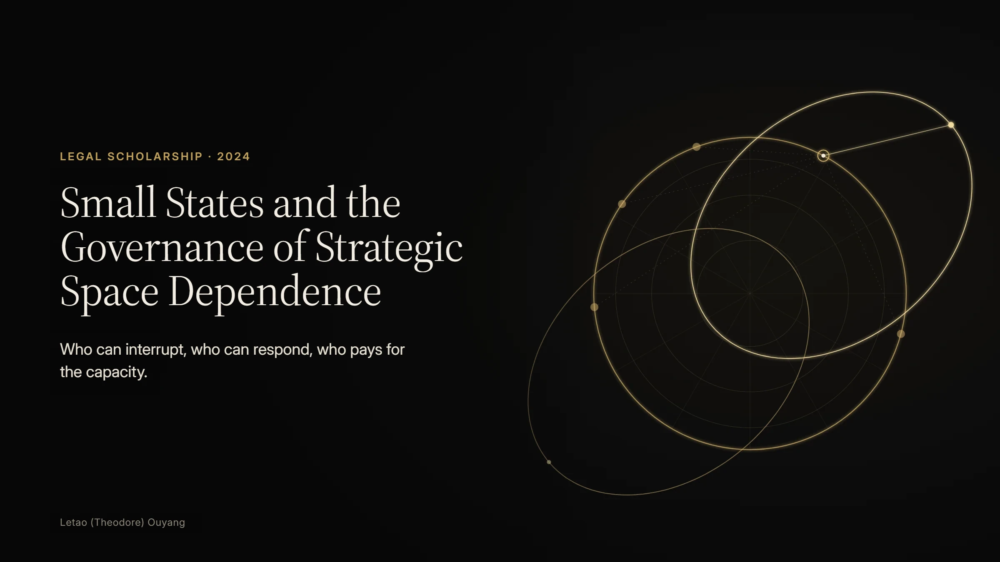
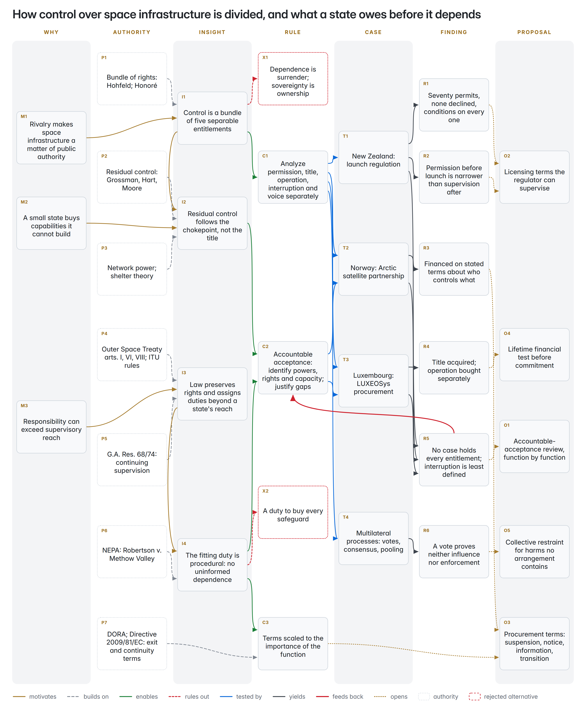

# Small States and the Governance of Strategic Space Dependence

**Letao (Theodore) Ouyang** · Duke Law School · December 2024; revised November 2026

[Article](manuscript/small-states-and-the-governance-of-strategic-space-dependence.md) · [PDF](paper/paper.pdf) · [Argument map](docs/argument-map.md) · [Proposal](docs/proposal.md) · [Research route](docs/research-route.md) · [Literature](docs/literature.md)

**When a small state relies on foreign space infrastructure, what exactly has it given up, and what does it owe its own public before it does so?**

A small state can license a launch, own a satellite or buy a service, and still lack the decision it meant to
keep. This Article argues that control over space infrastructure is a bundle of separable entitlements, and that
the residual power to decide in a crisis follows the chokepoint more than the title. A structured comparison of
New Zealand's launch regulation, Norway's Arctic satellite partnership and Luxembourg's LUXEOSys procurement, read
from administrative records, shows the entitlements divided among a regulator, an owner, an operator and a
supplier's government. The Article proposes a standard of accountable acceptance: authorities identify
interruption powers, usable response rights and funded implementation capacity, and justify material gaps before
commitment. The standard is procedural in the way environmental review is procedural. It forbids uninformed
dependence and leaves the choice to depend with the responsible authority.

## Three claims to start with

| Claim | Why it matters | Where |
| --- | --- | --- |
| **Control is a bundle of five entitlements, and the residual right in a crisis follows the chokepoint.** Permission, title, operation, interruption and priority, and voice can sit in different hands, and the party that holds a control segment, an export license or a ground station decides what the contract did not foresee | The debate about space "sovereignty" has lacked a concept. Dependence and ownership stop being opposites, and the question becomes who holds which decision | [Part II](manuscript/small-states-and-the-governance-of-strategic-space-dependence.md) · [Argument map](docs/argument-map.md#part-ii-defining-the-comparison-and-the-mechanisms) |
| **No state in the comparison holds every entitlement, and the power to interrupt is the one the public record leaves least defined.** New Zealand granted seventy payload permits and declined none; Norway's legislature financed a partnership on stated terms of control; Luxembourg acquired title and bought operation separately for EUR75 million | The account is tested against an intelligence oversight review, a statutory review, a parliamentary financing recommendation and a public audit, in place of capability rankings | [Part IV](manuscript/small-states-and-the-governance-of-strategic-space-dependence.md) · [Argument map](docs/argument-map.md#part-iv-three-arrangements-and-their-limits) |
| **Accountable acceptance is a procedural duty.** Like the National Environmental Policy Act, it prohibits uninformed commitment and leaves the substantive choice to the responsible authority | The standard costs suppliers only what the buyer chooses to negotiate, and it gives legislatures and auditors something to review | [Part VI](manuscript/small-states-and-the-governance-of-strategic-space-dependence.md) · [Proposal](docs/proposal.md#2-accountable-acceptance-review) |

## The problem

Great-power competition makes the reliability and the permissible uses of space infrastructure matters of public
authority. Foreign dependence has no uniform relationship with a small state's autonomy: cooperation can supply
capabilities that are otherwise out of reach, and ownership can leave essentials in someone else's hands.
International space law preserves important state rights and assigns responsibilities, for authorization and
continuing supervision, that may exceed a small administration's practical reach. It supplies neither access to
another actor's systems nor continuity of a purchased service.

## The argument in brief

1. **The comparison and its concepts** (Part II). Practical autonomy is the capacity to make and implement a
   specified lawful public decision. Control is five entitlements, and residual control follows the chokepoint.
   Shelter theory explains why a small state enters a dependent relationship; this Article explains how decisions
   are allocated inside it.
2. **What international law supplies and what it leaves open** (Part III). Rights of use, responsibility and
   registry jurisdiction, with agreed guidance on continuing supervision. Export law already treats platform and
   payload as different legal objects.
3. **Three arrangements** (Part IV). New Zealand: permission, exercised through conditions, and narrower than
   supervision after launch. Norway: national ownership and command inside a partnership financed on stated terms.
   Luxembourg: title without the capacity to operate, authorized without an account of the difference.
4. **Participation and influence** (Part V). A vote proves neither influence nor enforcement, and consensus
   equalizes the rule and not the resources to sustain negotiation.
5. **Safeguards for accountable choice** (Part VI). The standard, the kind of duty it is, and its translation into
   licensing and procurement terms.

## The entitlements, case by case

| Entitlement | New Zealand (launch regulation) | Norway (ASBM) | Luxembourg (LUXEOSys) |
| --- | --- | --- | --- |
| Permission | Held, and exercised through conditions on every permit | Not at issue: the state owns the operator | Not at issue: a state program |
| Title | Not held: the payloads belong to foreign operators | Held: Space Norway owns the platforms | Held |
| Operation | Not held | Platform command held; the American and commercial payloads are separate | Contracted to a third-party provider, with antennas on rented infrastructure abroad |
| Interruption and priority | Before launch only | Not resolved by the published terms | Not documented in the audit |

The table states the thesis in one view. Residual control follows the chokepoint, and a title or a license shows
where it lies only by coincidence.

## What the Article contributes

1. **A concept for the debate about space sovereignty.** Ownership as a bundle of incidents, from property theory,
   and real ownership as the residual right to decide, from the economics of incomplete contracts, applied to
   space infrastructure.
2. **A test against administrative records.** The claims rest on what an oversight body, a statutory review, a
   legislature and an audit court recorded.
3. **The kind of duty accountable acceptance is.** A procedural duty of informed decision, with the National
   Environmental Policy Act as its structural model.
4. **Licensing terms for a risk the agreed guidance does not name.** The General Assembly's recommendations on
   national space legislation, applied to dependence on a foreign input.
5. **Procurement terms with models in force.** Exit, notice, transition and disclosure clauses from European
   financial regulation and defense procurement, with the claim that their absence from an essential space
   function is something a named decision maker has to explain.

[Where this Article sits](docs/literature.md) sets these against small-state theory, the literature on network
power and space law, and the [bibliography](docs/bibliography.md) lists all 186 authorities and sources.

## The proposal

For each specified public function an authority records who can interrupt it, what information and rights permit a
response, what funded capacity makes the response feasible, where those fall short, and who accepts the gap, with
legislative or confidential review where the function warrants it. Requirements scale with the importance of the
function. The [proposal](docs/proposal.md) sets out the entitlement map, the review, the licensing terms, the
procurement terms and the financial test as a checklist.

## How the argument was built

<picture>
  <source media="(prefers-color-scheme: dark)" srcset="assets/route-dark.png">
  
</picture>

The route is a network. The concept of control, the cases and the standard were worked out against each other.

- **What control consists of.** Five entitlements, and the finding that the residual right follows the chokepoint,
  rule out the equation of dependence with surrender.
- **Three cases.** No state holds every entitlement, and interruption is the least defined. That finding went back
  into the standard, which starts from interruption powers.
- **The duty that fits.** A state is entitled to choose dependence, so the duty is procedural, and it is not a duty
  to buy every safeguard.

The [research route](docs/research-route.md) explains all 34 steps and all 40 links.

## Repository

| Path | Contents |
| --- | --- |
| [`manuscript/`](manuscript/small-states-and-the-governance-of-strategic-space-dependence.md) | The Article, with its notes |
| [`paper/paper.pdf`](paper/paper.pdf) | The Article as a PDF |
| [`docs/argument-map.md`](docs/argument-map.md) | Each claim, the authority or record it rests on, the strongest objection and the response |
| [`docs/proposal.md`](docs/proposal.md) | The entitlement map, the accountable-acceptance review and the licensing and procurement terms as a checklist |
| [`docs/research-route.md`](docs/research-route.md) | The logic of the Article as a network, node by node |
| [`docs/literature.md`](docs/literature.md) · [`docs/bibliography.md`](docs/bibliography.md) | Where the Article sits, and the 186 authorities and sources |

## Citation

Letao (Theodore) Ouyang, *Small States and the Governance of Strategic Space Dependence* (Duke Law School, 2024),
<https://www.theodoreoy.com/experience/small-states-and-the-governance-of-strategic-space-dependence/>. See
[CITATION.cff](CITATION.cff).

[theodore.oy2025@gmail.com](mailto:theodore.oy2025@gmail.com) · [10@alumni.duke.edu](mailto:10@alumni.duke.edu)

© Letao (Theodore) Ouyang. All rights reserved.
