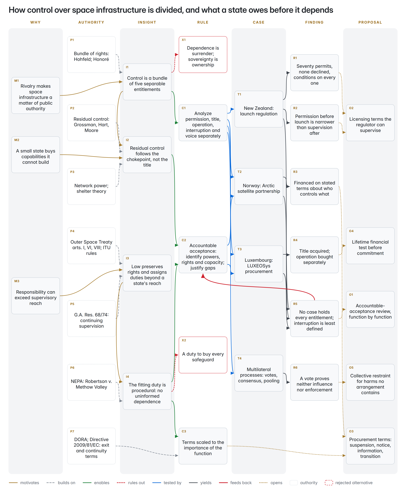

# Research route

How the argument was built: which body of authority supports which step, where the cases went back and changed a
rule, and what the rules become as instruments. The Article does not run from problem to solution in one line. The
concept of control, the three cases and the standard were worked out against each other, because a standard for
accepting dependence is only as good as its account of what a dependent state has given up.

<picture>
  <source media="(prefers-color-scheme: dark)" srcset="../assets/route-dark.png">
  
</picture>

## Reading the figure

Columns are kinds of step, not stages in time. A link can run between any two columns, and one runs backwards,
from a finding to a rule.

| Link | Meaning |
| --- | --- |
| motivates | A problem or an insight that made the next step necessary |
| builds on | An authority the step rests on |
| enables | A step that makes another one possible |
| tested by / yields | A rule and the case that tests it; a case and what it shows |
| feeds back | A finding that changed a rule |
| rules out | A step that excludes an alternative |
| opens | A rule or finding that becomes an instrument |

Solid boxes are the Article's own steps. Dotted boxes are authority, and red dashed boxes are positions the Article
rejects.

## The three threads

### 1. What control consists of

M1 → I1 → I2, with M2 → I2, I1 → C1 and I1 ruling out X1.

Great-power competition makes the reliability and the permissible uses of space infrastructure a public question
(M1), and a small state buys capabilities it cannot build (M2). The debate asks whether such a state is dependent
or sovereign. Property theory treats ownership as a bundle of separable incidents (P1), and the Article reads
control over a space system the same way (I1): permission, title, operation, interruption and priority, and voice
can sit in different hands. That rules out the equation of dependence with surrender and of sovereignty with
ownership (X1).

The economics of incomplete contracts adds which entitlement matters (P2): the residual right to decide what the
contract did not foresee. With the literature on network power (P3), that gives the Article's central finding
about structure (I2). The residual right in a crisis follows the chokepoint, a control segment, an export license
or a ground station, whatever the title says. The rule of method follows (C1): each entitlement is located before
any conclusion about autonomy is drawn.

### 2. Three cases and the multilateral record

C1, C2 → T1 to T4 → R1 to R6, with R5 feeding back into C2.

- **New Zealand (T1).** The state holds permission and neither title nor operation. Its statutory review records
  seventy payload permits, none declined and conditions on every one (R1): the lever is the condition. The same
  review records that remote-sensing products can be resold with no guarantee about where they end up (R2), so
  permission before launch is narrower than supervision after it.
- **Norway (T2).** The state holds title and platform command inside a partnership. The Storting financed it on
  stated terms about who would control what (R3).
- **Luxembourg (T3).** The state holds title and contracted out operation at EUR75 million, with antennas on
  rented infrastructure abroad (R4). The gap in information was on the record before the commitment.
- **Multilateral processes (T4).** A vote proves neither influence nor enforcement (R6), and consensus equalizes
  the rule without equalizing the resources to sustain negotiation.

Read together the cases show that no state holds every entitlement, and that the one that decides a crisis, the
power to interrupt, is the one the public record leaves least defined (R5). That finding went back into the
standard (R5 → C2): accountable acceptance starts from interruption powers.

### 3. The duty that fits

M3 → I3 → I4 → C2, C3, with I4 ruling out X2.

International space law preserves rights and assigns responsibilities that can exceed a small state's supervisory
reach (M3, P4, P5), and it supplies neither access to another actor's systems nor continuity of a purchased
service (I3). A state is entitled to choose dependence, so the duty that fits is procedural (I4). The National
Environmental Policy Act is the model (P6): it prescribes process, prohibits uninformed action and leaves the
substantive choice to the agency. Accountable acceptance (C2) asks an authority to identify interruption powers,
usable response rights and funded capacity, and to justify material gaps before commitment. It is not a duty to buy
every safeguard (X2). What the process examines is scaled to the importance of the function (C3), and the clauses
themselves are in force in European financial regulation and defense procurement (P7).

## From findings to instruments

| Instrument | Comes from | What it does |
| --- | --- | --- |
| O1 Accountable-acceptance review | R5 | Asks, function by function, who can interrupt, what rights permit a response, what funded capacity makes it feasible, and who accepts the gap ([checklist](proposal.md)) |
| O2 Licensing terms | R1, R2 | Permitted uses, information the regulator can obtain and assess, a procedure for significant changes, and funded competence |
| O3 Procurement terms | R3, C3 | Suspension grounds, notice, operational information and transition |
| O4 Lifetime financial test | R4 | Feasible alternatives compared over the life of the system, with operation costed alongside title |
| O5 Collective restraint | R6 | Multilateral participation for harms that national arrangements cannot contain |

## Every node

| Node | Column | What it is |
| --- | --- | --- |
| **M1** Rivalry makes space infrastructure a matter of public authority | Why | Great-power competition makes the reliability and permissible uses of space infrastructure a public question. |
| **M2** A small state buys capabilities it cannot build | Why | Cooperation can supply capabilities that are otherwise unavailable, and it gives someone else a necessary input. |
| **M3** Responsibility can exceed supervisory reach | Why | International space law assigns responsibilities that may exceed what a small administration can supervise in practice. |
| **P1** Bundle of rights: Hohfeld; Honoré | Authority | Legal relations are distinct entitlements, and ownership is a set of incidents that need not have one holder. |
| **P2** Residual control: Grossman, Hart, Moore | Authority | Under incomplete contracts the owner is the party with the residual right to decide. |
| **P3** Network power; shelter theory | Authority | Farrell and Newman on chokepoints as leverage; Thorhallsson on why small states seek shelter. |
| **P4** Outer Space Treaty arts. I, VI, VIII; ITU rules | Authority | Freedom of use, responsibility with continuing supervision, registry jurisdiction, and equitable access to spectrum. |
| **P5** G.A. Res. 68/74: continuing supervision | Authority | Agreed guidance on national space legislation, including supervision that survives a transfer of control in orbit. |
| **P6** NEPA: Robertson v. Methow Valley | Authority | A duty that prescribes process and prohibits uninformed action, leaving the substantive choice to the agency. |
| **P7** DORA; Directive 2009/81/EC: exit and continuity terms | Authority | Exit strategies, notice and transition for outside technology providers; disclosure of restrictions and crisis capacity in defense procurement. |
| **I1** Control is a bundle of five separable entitlements | Insight | Permission, title, operation, interruption and priority, and voice can sit in different hands. |
| **I2** Residual control follows the chokepoint, not the title | Insight | The party that holds a control segment, an export license or a ground station decides what the contract did not foresee. |
| **I3** Law preserves rights and assigns duties beyond a state's reach | Insight | The treaties supply neither access to another actor's systems nor continuity of a purchased service. |
| **I4** The fitting duty is procedural: no uninformed dependence | Insight | Like environmental review, the duty forbids an uninformed commitment and leaves the choice with the responsible authority. |
| **X1** Dependence is surrender; sovereignty is ownership | Rule | Rejected: buying a capability can enlarge the decisions that are feasible, and ownership can leave essentials out of reach. |
| **C1** Analyze permission, title, operation, interruption and voice separately | Rule | Each entitlement is located before any conclusion about autonomy is drawn. |
| **C2** Accountable acceptance: identify powers, rights and capacity; justify gaps | Rule | Authorities identify interruption powers, usable response rights and funded implementation capacity, and justify material gaps before commitment. |
| **X2** A duty to buy every safeguard | Rule | Rejected: a duty to give reasons is a burden on the buyer's own process, scaled to the importance of the function. |
| **C3** Terms scaled to the importance of the function | Rule | Suspension grounds, notice, information and transition, required in proportion to the consequences of interruption. |
| **T1** New Zealand: launch regulation | Case | The Outer Space and High-altitude Activities Act 2017 and its reviews. |
| **T2** Norway: Arctic satellite partnership | Case | The Arctic Satellite Broadband Mission and the Storting's financing record. |
| **T3** Luxembourg: LUXEOSys procurement | Case | The Earth-observation satellite, the special audit and the Conseil d'État's opinion. |
| **T4** Multilateral processes: votes, consensus, pooling | Case | G.A. Res. 77/41, the open-ended working group, the Group of Governmental Experts and the ESA Convention. |
| **R1** Seventy permits, none declined, conditions on every one | Finding | The lever New Zealand uses is the condition, not the refusal. |
| **R2** Permission before launch is narrower than supervision after | Finding | Remote-sensing products can be resold with no guarantee about where they end up. |
| **R3** Financed on stated terms about who controls what | Finding | Military broadband under Norwegian control, no funds before binding customer agreements, ground station and operations center in Norway. |
| **R4** Title acquired; operation bought separately | Finding | Operation was contracted to a third-party provider at EUR75 million, with antennas on rented infrastructure in Belgium. |
| **R5** No case holds every entitlement; interruption is least defined | Finding | The power that decides a crisis is the one the public record leaves least defined. |
| **R6** A vote proves neither influence nor enforcement | Finding | Consensus equalizes the rule and not the resources to sustain negotiation. |
| **O2** Licensing terms the regulator can supervise | Proposal | Permitted uses, information the regulator can obtain and assess, a procedure for significant changes, and funded competence. |
| **O4** Lifetime financial test before commitment | Proposal | Feasible alternatives compared over the life of the system, including operation, with revisions to parliament while choices remain open. |
| **O1** Accountable-acceptance review, function by function | Proposal | Who can interrupt, what rights permit a response, what funded capacity makes it feasible, and who accepts the gap. |
| **O5** Collective restraint for harms no arrangement contains | Proposal | Multilateral participation and restraint remain necessary for debris and cross-border disruption. |
| **O3** Procurement terms: suspension, notice, information, transition | Proposal | The terms an essential service is bought on, with their models in European financial and defense procurement law. |

## Every link

| # | From | To | Link | Why |
| ---: | --- | --- | --- | --- |
| 1 | M1 | I1 | motivates | If control is a public question, it has to be said what control consists of |
| 2 | P1 | I1 | builds on | Ownership as a bundle of separable incidents |
| 3 | I1 | I2 | motivates | Once the entitlements are separated, the question is which one decides a crisis |
| 4 | M2 | I2 | motivates | A purchased capability runs through someone else's necessary input |
| 5 | P2 | I2 | builds on | Ownership is the residual right to decide |
| 6 | P3 | I2 | builds on | A chokepoint with jurisdiction over it is leverage |
| 7 | I1 | X1 | rules out | Sovereignty over a space system is not one thing a state has or lacks |
| 8 | I1 | C1 | enables | Each entitlement is analyzed where it sits |
| 9 | M3 | I3 | motivates | Responsibility without the means to supervise is the gap |
| 10 | P4 | I3 | builds on | What the treaties supply and what they leave open |
| 11 | P5 | I3 | builds on | Agreed guidance on authorization and continuing supervision |
| 12 | I3 | I4 | motivates | Where the law leaves the gap, the duty has to fit a choice the state is entitled to make |
| 13 | P6 | I4 | builds on | A duty that prohibits uninformed action |
| 14 | I2 | C2 | enables | The review begins with who can interrupt |
| 15 | I4 | C2 | enables | Identify, explain and decide, on a record that can be reviewed |
| 16 | I4 | X2 | rules out | A procedural duty does not prescribe the purchase |
| 17 | I4 | C3 | enables | What the process examines is scaled to the function |
| 18 | P7 | C3 | builds on | The clauses are in force in other sectors |
| 19 | C1 | T1 | tested by | A state that holds permission and neither title nor operation |
| 20 | C1 | T2 | tested by | A state that holds title and platform command within a partnership |
| 21 | C1 | T3 | tested by | A state that holds title and contracts out operation |
| 22 | C1 | T4 | tested by | Voice, the fifth entitlement |
| 23 | C2 | T2 | tested by | A legislature that attached conditions before commitment |
| 24 | C2 | T3 | tested by | A commitment made without an account of operation |
| 25 | T1 | R1 | yields | How the permission is exercised |
| 26 | T1 | R2 | yields | What the permission cannot reach |
| 27 | T2 | R3 | yields | The financing record |
| 28 | T3 | R4 | yields | What the title did not include |
| 29 | T1 | R5 | yields | The entitlements New Zealand holds |
| 30 | T2 | R5 | yields | The entitlements Norway holds |
| 31 | T3 | R5 | yields | The entitlements Luxembourg holds |
| 32 | T4 | R6 | yields | What participation delivers |
| 33 | R5 | C2 | feeds back | The standard therefore starts from interruption powers, the entitlement the record leaves least defined |
| 34 | R1 | O2 | opens | Conditions are the working lever of a permission |
| 35 | R2 | O2 | opens | Supervision after launch needs information the regulator can obtain |
| 36 | R3 | O3 | opens | Stated terms about control, written before funds are released |
| 37 | C3 | O3 | opens | The scaled terms become contract clauses |
| 38 | R4 | O4 | opens | Operation is costed with the title |
| 39 | R5 | O1 | opens | The review asks first who can interrupt |
| 40 | R6 | O5 | opens | National safeguards do not contain collective harms |
